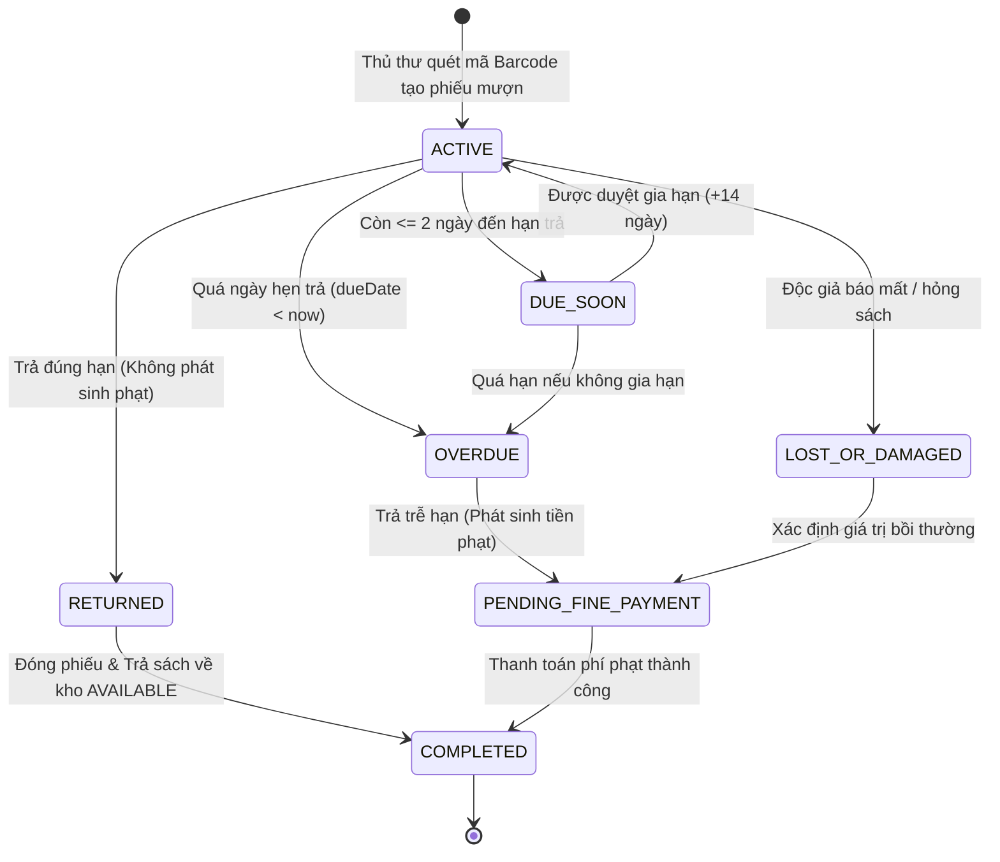
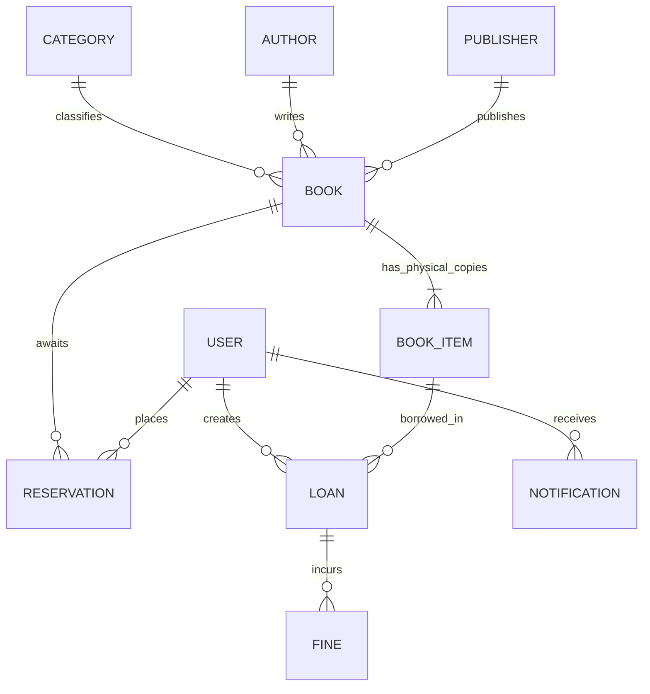

# 📚 Hệ Thống Quản Lý Thư Viện Số Thông Minh (Smart Library Management System)

<div align="center">


[](https://github.com/nguyenbathuy/library-management-system/actions/workflows/ci.yml)


**Giải pháp chuyển đổi số toàn diện cho công tác quản lý học liệu và lưu thông sách học đường.**  
*Tích hợp Kiến trúc Máy trạng thái (State Machine), Tự động hóa tác vụ ngầm (Cronjob) và Phân quyền bảo mật đa lớp (RBAC).*

[🎯 Mục tiêu](#1--mục-tiêu-dự-án) • [🏗️ Kiến trúc & Công nghệ](#2-️-kiến-trúc--công-nghệ-tech-stack) • [⚡ Tính năng nổi bật](#3--tính-năng-nổi-bật-key-features) • [🔄 Quy trình Vòng đời (State Machine)](#4--quy-trình-vòng-đời-phiếu-mượn-state-machine) • [📋 Chức năng cốt lõi (CRUD)](#5--danh-sách-chức-năng-cốt-lõi-crud) • [🚀 Cài đặt & Khởi chạy](#6--hướng-dẫn-cài-đặt--khởi-chạy) • [👥 Tài khoản thử nghiệm](#7--tài-khoản-thử-nghiệm) • [🧪 Chạy kiểm thử](#9--hướng-dẫn-chạy-kiểm-thử)

</div>

---

## 1. 🎯 Mục tiêu dự án

Hệ thống được thiết kế và xây dựng theo chuẩn mực thư viện số đại học hiện đại, giải quyết triệt để các hạn chế của quy trình ghi chép thủ công truyền thống:

* 📖 **Mô hình thực thể chuẩn hóa**: Tách bạch giữa **Đầu sách (Book Title)** và **Bản sao vật lý (BookItem)**, định danh từng cuốn sách độc nhất thông qua mã vạch Barcode và vị trí lưu trữ cụ thể trên từng kệ sách.
* ⚡ **Tự động hóa tác vụ thủ thư**: Tăng tốc độ giao dịch mượn/trả xuống dưới 1 giây bằng đầu đọc mã vạch Barcode POS, nhập kho hàng loạt từ file Excel và tự động phân luồng đặt trước (Reservation Queue).
* ⚙️ **Quản trị vòng đời bằng State Machine**: Khóa chặt các chuyển dịch trạng thái của phiếu mượn (`ACTIVE` $\rightarrow$ `OVERDUE` $\rightarrow$ `COMPLETED`), ngăn ngừa tình trạng dữ liệu mồ côi hoặc thất thoát sách.
* 💰 **Kỷ cương tài chính chặt chẽ**: Tự động tính toán mức phạt quá hạn theo ngày và đền bù sách mất/hỏng; khóa chức năng mượn và đóng phiếu cho tới khi nghĩa vụ tài chính được tất toán.
* 🔔 **Truyền thông sự kiện đa kênh (Event-Driven)**: Kết hợp chuông thông báo In-app thời gian thực và tiến trình nền (Cronjob) gửi Email HTML tự động nhắc hạn mỗi sáng.
* 📊 **Trực quan hóa chỉ số KPI**: Bảng điều khiển và chức năng xuất báo cáo thống kê PDF chuẩn A4, với mục tiêu hiển thị tiếng Việt không lỗi font.

---

## 2. 🏗️ Kiến trúc & Công nghệ (Tech Stack)

Hệ thống tuân thủ kiến trúc phân tầng **Client - Server (RESTful API)** với chuẩn mã nguồn đồng nhất bằng **TypeScript**:

```
┌────────────────────────────────────────────────────────────────────────┐
│                   GIAO DIỆN CLIENT (SPA - React 18 + Vite 6)           │
│   • Tailwind CSS 4, Radix UI Primitives, Lucide Icons, Recharts        │
│   • TanStack Query (React Query v5) - Server State Caching & Mutate    │
│   • html2canvas-pro + jsPDF - Kết xuất PDF tiếng Việt Unicode chuẩn A4 │
└───────────────────────────────────┬────────────────────────────────────┘
                                    │ HTTP / REST API (Axios + Bearer JWT)
                                    ▼
┌────────────────────────────────────────────────────────────────────────┐
│               MÁY CHỦ BACKEND (Node.js 20 + Express 5 + TypeScript)    │
│   • Controllers & Routes phân tầng, kiến trúc RESTful chuẩn mực        │
│   • State Machine Validator & Risk Evaluation Engine (Kiểm soát 3 lớp) │
│   • Background Services: node-cron (Scheduler) + Nodemailer (Email)    │
│   • Data Ingestion: Multer (Memory Storage) + xlsx (SheetJS)           │
└───────────────────────────────────┬────────────────────────────────────┘
                                    │ Prisma ORM 5.22
                                    ▼
┌────────────────────────────────────────────────────────────────────────┐
│                     CƠ SỞ DỮ LIỆU QUAN HỆ (SQLite)                    │
│   • User, Token, Book, BookItem, Category, Author, Publisher,          │
│     Loan, Fine, Reservation, Notification, AuditLog                    │
└────────────────────────────────────────────────────────────────────────┘
```

### 2.1. Phía Frontend
* **Core Framework**: `React 18.3` kết hợp bộ bundler siêu tốc `Vite 6` và `TypeScript 5.9`.
* **Quản lý dữ liệu Server**: `@tanstack/react-query` v5 tối ưu hóa bộ nhớ đệm, tự động refetch và loại bỏ cache (cache invalidation) ngay khi dữ liệu được cập nhật.
* **Giao diện & Trải nghiệm (UI/UX)**:
  - `Tailwind CSS 4`: Công cụ styling tiện ích thế hệ mới với hiệu năng biên dịch vượt trội.
  - `@radix-ui/*`: Bộ thư viện thành phần giao diện không style (headless) đạt chuẩn truy cập Accessibility (a11y).
  - `Lucide React`: Hệ thống icon vector tối giản, sắc nét.
  - `Recharts`: Biểu đồ trực quan hóa dữ liệu xu hướng mượn sách theo từng tháng.
  - Hỗ trợ chế độ giao diện **Dark Mode / Light Mode** và chuyển đổi **Song ngữ (Việt - Anh)** linh hoạt.
* **Kết xuất tài liệu báo cáo**: Dashboard sử dụng `html2canvas-pro` kết hợp `jspdf` để xuất file PDF báo cáo chuẩn A4. Chất lượng font cần đối chiếu file xuất và kết quả QA, không suy từ thư viện sử dụng.

### 2.2. Phía Backend
* **Nền tảng thực thi**: `Node.js 22.x` với framework `Express 5.x` viết toàn bộ bằng `TypeScript`; môi trường đã ghi nhận trong QA dùng Node.js `22.23.3`.
* **ORM & CSDL**: `Prisma ORM 5.22` kết nối SQLite cục bộ tại `server/prisma/dev.db`, theo datasource `file:./dev.db` trong schema hiện tại.
* **Bảo mật & Phân quyền**: Xác thực người dùng qua `jsonwebtoken` (JWT), mã hóa mật khẩu bằng `bcryptjs` (salt 10 rounds), bảo vệ route theo vai trò (RBAC: `ADMIN` / `USER`).

### 2.3. Bảng tổng hợp công nghệ & thư viện

| Công nghệ / Thư viện | Phân loại | Vai trò kỹ thuật trong hệ thống |
| :--- | :--- | :--- |
| **`React 18` + `Vite`** | Frontend Framework | Xây dựng giao diện ứng dụng đơn trang (SPA) phản hồi tức thì. |
| **`TypeScript`** | Programming Language | Đảm bảo tính toàn vẹn kiểu dữ liệu (Type Safety) trên toàn bộ hệ thống. |
| **`Prisma ORM`** | Database ORM | Định nghĩa Schema, quản lý Migration và truy vấn cơ sở dữ liệu quan hệ an toàn. |
| **`Tailwind CSS 4`** | CSS Framework | Thiết kế giao diện hiện đại, responsive, hỗ trợ Dark Mode và animation. |
| **`xlsx` (SheetJS)** | File Processing | Đọc và bóc tách dữ liệu từ file Excel (.xlsx, .xls) đưa vào bộ nhớ đệm. |
| **`multer`** | Middleware | Tiếp nhận upload file trực tiếp trong RAM (`memoryStorage`), không tạo file rác. |
| **`node-cron`** | Task Scheduler | Lập lịch tiến trình chạy ngầm quét hạn mượn vào 08:00 sáng mỗi ngày (`0 8 * * *`). |
| **`nodemailer`** | Mail Engine | Gửi email thông báo tự động (hỗ trợ Gmail SMTP và Ethereal Mail giả lập). |
| **`html2canvas-pro` & `jspdf`** | Export Engine | Chụp ảnh DOM chuẩn Unicode và đóng gói thành file PDF báo cáo A4 chuyên nghiệp. |

---

## 3. ⚡ Tính năng nổi bật (Key Features)

```
       QUẢN LÝ KHO THÔNG MINH               LUỒNG PHÊ DUYỆT & TÀI CHÍNH
  ┌──────────────────────────────┐        ┌──────────────────────────────┐
  │ • Smart Inventory Merge      │        │ • Approval Workflow (Gia hạn)│
  │ • Bulk Import Excel          │        │ • Auto Fine Calculation      │
  │ • Barcode Audit & Check      │        │ • Khóa phiếu chờ nộp phạt    │
  └──────────────┬───────────────┘        └──────────────┬───────────────┘
                 │                                       │
                 └───────────────────┬───────────────────┘
                                     ▼
                      HỆ THỐNG THÔNG BÁO & BÁO CÁO
              ┌─────────────────────────────────────────────┐
              │ • In-app Realtime Notifications (Chuông)    │
              │ • Automated Cronjob Email (08:00 AM)        │
              │ • Báo cáo PDF tiếng Việt Unicode chuẩn A4   │
              └─────────────────────────────────────────────┘
```

### 3.1. 📦 Quản lý Kho thông minh (Smart Inventory Management)
* **Tự động gộp kho khi nhập sách trùng (Smart Inventory Merge)**: Khi nhập thêm sách có cùng mã ISBN đã tồn tại, hệ thống không tạo đầu sách trùng lặp mà tự động sinh thêm $N$ bản sao vật lý (`BookItem`) với mã vạch nối tiếp, tự động cập nhật số lượng tồn kho.
* **Nhập sách hàng loạt bằng Excel (Bulk Import)**: Tiếp nhận file Excel với cấu trúc linh hoạt (tự động nhận diện tiêu đề tiếng Việt hoặc tiếng Anh: `Tên sách`, `title`, `Tác giả`, `author`, `Số lượng`, `copies`...). Toàn bộ thao tác đều được lưu vết vào bảng `AuditLog`.
* **Kiểm kê kho thực tế & đối chiếu (Barcode Inventory Audit)**:
  - Cho phép thủ thư cầm máy quét quét liên tục các cuốn sách thực tế trên kệ.
  - Tự động phân loại và đối chiếu tức thì thành 3 nhóm: **Sách hợp lệ** (Khớp kho), **Sách bị thiếu** (Có trong CSDL nhưng không thấy trên kệ), **Sách bất thường** (Sai vị trí kệ hoặc sai trạng thái).
  - Tích hợp Modal **"Xem chi tiết kho dự kiến"** với tính năng tìm kiếm nhanh theo thời gian thực (Real-time Filter) theo mã vạch, tên sách, tác giả, vị trí kệ.

### 3.2. 📝 Luồng phê duyệt gia hạn (Approval Workflow)
* **Quyền chủ động của độc giả**: Độc giả có thể gửi yêu cầu xin gia hạn sách trực tiếp trên giao diện cá nhân trước khi sách bị quá hạn.
* **Quyền phê duyệt của thủ thư**: Thủ thư kiểm tra lịch sử mượn, nhu cầu đặt trước của các bạn đọc khác và quyết định **Phê duyệt (Approve)** hoặc **Từ chối (Reject)** kèm lý do cụ thể.
* **Tự động cập nhật hạn trả**: Khi được phê duyệt, hệ thống tự động cộng thêm thời gian mượn (VD: +7 hoặc +14 ngày) và gửi thông báo xác nhận đến độc giả.

### 3.3. 💰 Xử lý tài chính & Phạt quá hạn chặt chẽ (Financial & Penalty Control)
* **Tự động tính phí phạt**: Mỗi ngày trễ hạn, hệ thống tự động tính lũy tiến tiền phạt (VD: 5.000 VNĐ / ngày / cuốn).
* **Khóa phiếu chờ thanh toán**: Khi độc giả mang sách đến trả muộn hoặc báo mất/hỏng sách, phiếu mượn được chuyển sang trạng thái `PENDING_FINE_PAYMENT`.
* **Ràng buộc an toàn**: Phiếu mượn **chỉ được đóng hoàn toàn (`COMPLETED`)** sau khi khoản phí phạt hoặc tiền đền bù sách mất được thanh toán dứt điểm. Đồng thời, độc giả đang nợ phạt sẽ bị hệ thống tự động từ chối mọi yêu cầu mượn sách mới.

### 3.4. 🔔 Hệ thống Thông báo đa kênh (Event-Driven Notification)
* **Chuông thông báo In-app thời gian thực**: Biểu tượng chuông thông báo trên thanh tiêu đề hiển thị số lượng tin chưa đọc, cập nhật ngay khi:
  - Sách được duyệt cho mượn hoặc gia hạn thành công.
  - Sách đặt trước đã có mặt tại thư viện sẵn sàng nhận.
  - Nhắc nhở nợ sách sắp đến hạn hoặc phát sinh phí phạt.
* **Cronjob gửi Email tự động lúc 08:00 sáng**:
  - `node-cron` quét toàn bộ phiếu mượn trong hệ thống mỗi ngày.
  - Gửi email định dạng HTML chuyên nghiệp: **Màu xanh nhắc nhở** khi còn 1-2 ngày đến hạn; **Màu đỏ cảnh báo khẩn cấp** khi sách đã quá hạn.

### 3.5. 📊 Xuất báo cáo PDF chuẩn hóa tiếng Việt (Unicode PDF Export)
* **Render trực tiếp qua HTML & Canvas**: Dashboard kết xuất nội dung qua `html2canvas-pro` và đóng gói bằng jsPDF. Hiển thị tiếng Việt trong file PDF xuất ra (Dashboard và báo cáo kiểm kê) là một hạn chế đã biết chưa được xử lý.
* **Định dạng báo cáo chuẩn mực**: Bổ sung đầy đủ Logo trường Đại học Phenikaa, tiêu đề báo cáo chính thức, thời gian xuất báo cáo thực tế, tên thủ thư lập báo cáo, thẻ KPI thống kê, đồ thị xu hướng và danh sách hoạt động.
* **Hỗ trợ chia trang tự động**: Tự động tính toán tỷ lệ khổ giấy A4 Landscape và phân trang mượt mà nếu nội dung dài.

---

## 4. 🔄 Quy trình Vòng đời phiếu mượn (State Machine)

Toàn bộ nghiệp vụ lưu thông sách được điều khiển bởi Máy trạng thái hữu hạn (Finite State Machine), đảm bảo dữ liệu luôn nhất quán:



### Chi tiết các trạng thái:
1. **`ACTIVE`**: Sách đang được mượn hợp lệ, độc giả sử dụng sách bình thường.
2. **`DUE_SOON`**: Sắp đến hạn hoàn trả (hệ thống gửi email nhắc nhở).
3. **`OVERDUE`**: Quá hạn trả sách, hệ thống bắt đầu tính phạt và kích hoạt cờ cảnh báo rủi ro.
4. **`PENDING_FINE_PAYMENT`**: Sách đã được mang về thư viện nhưng độc giả còn nợ phí phạt quá hạn hoặc phí bồi thường sách mất. Tài khoản bị tạm khóa quyền mượn sách mới.
5. **`COMPLETED`**: Tất cả nghĩa vụ (trả sách vật lý và nộp đủ tiền phạt) đã hoàn tất. Sách vật lý chuyển về trạng thái `AVAILABLE` trên kệ.

---

## 5. 📋 Danh sách Chức năng cốt lõi (CRUD)

Mô hình dữ liệu quan hệ được thiết kế chặt chẽ và chuẩn hóa:



### 5.1. 📖 Quản lý Danh mục & Đầu sách (Book Management)
* Quản lý thông tin chi tiết: Tên sách, mã chuẩn ISBN (Unique), Thể loại, Tác giả, Nhà xuất bản, Năm xuất bản, Số trang, Ngôn ngữ, Tóm tắt nội dung và Ảnh bìa.
* Tự động chuẩn hóa dữ liệu: Danh mục Tác giả (`Author`), Thể loại (`Category`), Nhà xuất bản (`Publisher`) tự động `upsert` chống trùng lặp dữ liệu.
* Ràng buộc xóa an toàn: Tuyệt đối không cho phép xóa đầu sách nếu vẫn còn bản sao vật lý đang được mượn (`status = BORROWED`).

### 5.2. 🏷️ Quản lý Bản sao vật lý (`BookItem`)
* Mỗi cuốn sách thực tế là một thực thể độc lập có mã vạch riêng (`BC-{ISBN}-{Index}`) và vị trí kệ sách (`location`).
* Vòng đời trạng thái: `AVAILABLE` (Sẵn sàng) $\rightarrow$ `BORROWED` (Đang mượn) $\rightarrow$ `LOST` (Báo mất) / `DAMAGED` (Hư hỏng cần thanh lý).

### 5.3. 👤 Quản lý Độc giả & Phân quyền (Member Management & RBAC)
* Phân loại hạng thành viên với hạn mức mượn tương ứng:
  - `STANDARD`: Mượn tối đa **5 cuốn**, thời hạn 14 ngày.
  - `PREMIUM`: Mượn tối đa **10 cuốn**, thời hạn 30 ngày.
  - `LECTURER`: Mượn tối đa **15 cuốn**, thời hạn 60 ngày.
* **Danh sách đen (Blacklist)**: Khóa tạm thời hoặc vĩnh viễn các độc giả vi phạm quy chế thư viện.

### 5.4. 🔖 Hàng đợi Đặt trước sách (Book Reservation Queue)
* Khi toàn bộ bản sao của một đầu sách đều hết (`available = 0`), độc giả có thể bấm **Đặt trước (Reserve)**.
* Hệ thống xếp hàng chờ tự động theo nguyên tắc đến trước phục vụ trước (FIFO). Khi sách được trả về, hệ thống tự động ưu tiên gán cho người đầu tiên trong hàng đợi.

---

## 6. 🚀 Hướng dẫn Cài đặt & Khởi chạy

### Yêu cầu tiên quyết
* **Node.js 22 LTS** và **npm 10** (đã kiểm tra với Node.js `22.23.3`, npm `10.9.9`), **Git**.
* Dự án dùng SQLite qua Prisma; không cần cài MySQL/PostgreSQL.

### Bước 1: Lấy mã nguồn và cài dependencies

```bash
git clone https://github.com/nguyenbathuy/library-management-system.git
cd library-management-system

npm ci                  # Frontend (thư mục gốc)
npm --prefix server ci  # Backend
```

`node_modules/` không được commit; dùng `npm ci` để cài đúng binary của hệ điều hành (không sao chép `node_modules` giữa Windows và Linux).

### Bước 2: Cấu hình biến môi trường

Tệp `server/.env` **không được commit** (chứa bí mật). Tạo từ tệp mẫu rồi điền giá trị riêng:

```bash
cp server/.env.example server/.env
```

```env
PORT=5000
JWT_SECRET="doi_thanh_chuoi_bi_mat_rieng"

# (Tùy chọn) gửi email thật qua SMTP. Để trống thì mailService dùng tài khoản Ethereal giả lập (cần mạng).
# SMTP_HOST=smtp.gmail.com
# SMTP_PORT=587
# SMTP_USER=
# SMTP_PASS=
# SMTP_FROM=
```

Đường dẫn SQLite được khai báo trực tiếp là `file:./dev.db` trong `server/prisma/schema.prisma`, tức `server/prisma/dev.db`; biến `DATABASE_URL` không đổi kết nối này. Backend đăng ký cron nhắc hạn lúc 08:00 mỗi ngày theo múi giờ máy; tác vụ này có thể cập nhật trạng thái/phí phạt/thông báo và gửi email theo cấu hình.

### Bước 3: Tạo Prisma Client và cơ sở dữ liệu

Tệp `server/prisma/dev.db` không được commit, nên cần tạo CSDL mới và nạp dữ liệu mẫu:

```bash
cd server
npx prisma generate               # tạo Prisma Client cho hệ điều hành hiện tại
npx prisma db push                # tạo CSDL SQLite từ schema
npx ts-node src/seed.ts           # nạp tài khoản và dữ liệu mẫu
cd ..
```

**Seed xóa các bản ghi mượn, bản sao sách, đặt trước và danh mục cũ trước khi tạo dữ liệu mẫu; chỉ chạy trên CSDL demo mới.** Lệnh `prisma generate` không tạo hoặc xóa dữ liệu.

### Bước 4: Khởi động hệ thống

Tại thư mục gốc, chạy đồng thời Frontend và Backend:

```bash
npm run dev
```

* 🌐 **Giao diện (Frontend)**: [http://localhost:5173](http://localhost:5173)
* 🔌 **API (Backend)**: [http://localhost:5000](http://localhost:5000) (chỉ là API, không có giao diện)

Frontend gọi cố định API ở `http://localhost:5000/api`, nên giữ cổng backend `5000`. Nếu `5173` hoặc `5000` đang bận, dừng tiến trình đang chiếm cổng rồi chạy lại; Vite có thể chuyển sang cổng khác khi `5173` bận, hãy dùng đúng URL Vite in ra. Dừng cả hai bằng **Ctrl+C**.

### Xử lý sự cố thường gặp
* Báo `Cannot find module '.prisma/client/default'`: chạy lại `npx prisma generate` trong thư mục `server`.
* Lỗi native module khi chuyển hệ điều hành: xóa `node_modules` và `server/node_modules`, rồi chạy lại Bước 1.
* API báo `Invalid credentials`: kiểm tra tài khoản ở mục 7; nếu CSDL mới chưa seed thì chạy lại Bước 3.

---

## 7. 👥 Tài khoản thử nghiệm

Sau khi chạy seed (Bước 3) có sẵn hai tài khoản demo:

| Vai trò (Role) | Email đăng nhập | Mật khẩu | Hạng thẻ | Quyền hạn & Nghiệp vụ khả dụng |
| :--- | :--- | :---: | :---: | :--- |
| 👑 **Thủ thư (Admin)** | `admin@library.com` | `123` | `PREMIUM` | Toàn quyền hệ thống: Quản trị kho sách, Nhập Excel, Quét Barcode POS mượn/trả, Kiểm kê kho, Bật/tắt Blacklist, Duyệt gia hạn, Kích hoạt Cronjob gửi email, Xuất báo cáo PDF. |
| 🎓 **Độc giả (User)** | `user@library.com` | `123` | `STANDARD` | Tra cứu danh mục sách, Đặt trước khi hết sách, Gửi yêu cầu gia hạn sách đang mượn, Xem lịch sử mượn & thông báo cá nhân. |

Mật khẩu `123` chỉ dùng cho môi trường demo cục bộ.

---

## 8. 📁 Cấu trúc thư mục dự án

```
library-management-system/
├── server/                               # Backend (Node.js / Express / Prisma)
│   ├── prisma/
│   │   ├── migrations/                   # Migration khởi tạo ban đầu
│   │   └── schema.prisma                 # Mô hình dữ liệu (Prisma Schema)
│   ├── src/
│   │   ├── controllers/                  # Nghiệp vụ API: analytics, auth, book, inventory, loan,
│   │   │                                 #   notification, payment, reservation
│   │   ├── jobs/reminderJob.ts           # Cronjob quét hạn & gửi email nhắc hạn
│   │   ├── middleware/auth.ts            # Xác thực JWT & phân quyền RBAC
│   │   ├── routes/                       # Định tuyến RESTful API
│   │   ├── services/                     # mailService, notificationService
│   │   ├── utils/loanRules.ts            # Hàm thuần: tiền phạt, hạn trả, hạn gia hạn
│   │   ├── index.ts                      # Điểm khởi chạy máy chủ Express
│   │   └── seed.ts                       # Nạp dữ liệu mẫu
│   ├── tests/                            # Unit, tích hợp, property-based (xem mục 9)
│   ├── .env.example                      # Mẫu biến môi trường (không commit .env)
│   └── package.json
├── src/                                  # Frontend (React 18 + Vite + Tailwind 4)
│   ├── app/
│   │   ├── api/client.ts                 # Axios client gắn Bearer Token
│   │   ├── components/                   # Các trang và thành phần giao diện
│   │   ├── contexts/                     # Trạng thái Auth, Theme, Ngôn ngữ
│   │   ├── App.tsx                       # Route & Route Guard
│   │   └── Layout.tsx
│   └── styles/                           # CSS tokens, Tailwind, theme
├── e2e/                                  # Kiểm thử E2E Playwright (pages, specs, fixtures, support)
├── .github/workflows/ci.yml              # CI: unit + tích hợp + E2E
├── vitest.backend.config.ts              # Runner unit
├── vitest.integration.config.ts          # Runner tích hợp API
├── playwright.config.ts                  # Runner E2E
├── stryker.config.mjs                    # Mutation testing (loanRules, authController)
├── stryker.extension.config.mjs          # Mutation testing mở rộng
├── eslint.config.mjs                     # Phân tích tĩnh
├── tsconfig.frontend.json                # Kiểm tra kiểu strict cho frontend
└── package.json                          # Cấu hình gói và script
```

---

## 9. 🧪 Hướng dẫn chạy kiểm thử

Mọi lệnh chạy **từ thư mục gốc của repo** sau khi đã hoàn thành Bước 1 và `npx prisma generate` ở Bước 3. Kiểm thử đơn vị và tích hợp **không cần bật ứng dụng, không cần `.env` và không đụng `server/prisma/dev.db`**: tầng tích hợp tự tạo SQLite tạm từ schema, tầng E2E tự bật backend thật cùng Vite trên một CSDL tạm riêng.

### Chuẩn bị (một lần)
```bash
npm ci && npm --prefix server ci
cd server && npx prisma generate && cd ..
npx playwright install chromium     # chỉ cần cho E2E
```

### Lệnh chính
| Lệnh | Việc làm |
| :--- | :--- |
| `npm test` | Unit + tích hợp |
| `npm run test:unit` / `npm run test:coverage` | Unit (mock Prisma, không DB, không mạng); `:coverage` đo V8 và kiểm tra ngưỡng |
| `npm run test:integration` / `npm run test:integration:coverage` | API qua supertest trên SQLite tạm, kể cả tải file Excel/e-book |
| `npm run test:property` | Property-based testing và fuzz API (fast-check) |
| `npm run test:e2e` | E2E Playwright trên Chromium; cổng `5000` và `5173` phải trống |
| `npm run test:mutation` / `npm run test:mutation:ext` | Mutation testing (Stryker) cho `loanRules` + `authController` / cho các controller và job còn lại |
| `npm run typecheck` | `tsc` cho backend, mã kiểm thử và E2E |
| `npm run typecheck:frontend` | `tsc --strict` cho `src/` (hiện còn một số lỗi đã biết) |
| `npm run lint` | ESLint toàn repo; `npm run lint:report` ghi báo cáo JSON |

Ví dụ chạy một phạm vi hẹp: `LMS_WB_SCOPE=loan npm run test:coverage`. `LMS_WB_SCOPE` nhận `all` (mặc định), `modules`, `whitebox`, `authentication`, `member`, `loan`, `property`.

### Cấu trúc mã kiểm thử
* `server/tests/unit/`: unit theo module (`auth`, `member`, `loan`, `inventory`, `reservation`, `payment`, `notification`, `analytics`, `book`, `mail`, `jobs`); `server/tests/integration/`: API theo router; `server/tests/property/`: property-based và fuzz API.
* `server/tests/helpers`, `setup`, `mocks`, `support`: tiện ích dùng chung (harness gọi controller, tạo SQLite tạm, factory dữ liệu, chặn mạng, mock Prisma).
* `e2e/`: Page Object (`pages`), kịch bản (`specs`), dữ liệu seed (`fixtures`) và trình khởi động máy chủ E2E (`support`).

### Quy ước kiểm thử
* **Cách ly dữ liệu:** unit mock Prisma trước khi nạp mã; tích hợp và E2E dùng SQLite tạm và kiểm tra hash `dev.db` không đổi nếu file này tồn tại; mail luôn bị stub/`jsonTransport`; unit chặn mọi truy cập mạng.
* **Ca lỗi đã biết:** viết theo đặc tả đúng và đánh dấu `test.fails` (Vitest) hoặc `test.fail` (Playwright) kèm mã lỗi `DEF-xxx`/`FIND-xx` trong chú thích; chúng được tính là "thất bại dự kiến". Để xem lý do thất bại thật, chạy lại với `test.fails` tắt: `node server/tests/support/verify-known-bugs.mjs vitest.backend.config.ts <file test>` (hoặc `vitest.integration.config.ts` cho tích hợp), và `E2E_SHOW_KNOWN_BUGS=1 npm run test:e2e` cho E2E. Khi một lỗi được sửa, ca tương ứng sẽ đạt và Vitest báo lỗi nếu quên gỡ `test.fails`.
* **Ngưỡng bao phủ:** unit (phạm vi `all`) tối thiểu 90% câu lệnh, 85% nhánh, 90% hàm, 90% dòng; tích hợp 75% / 65% / 85% / 75%. Dưới ngưỡng thì lệnh coverage thoát mã khác 0.
* **Tái hiện phản ví dụ ngẫu nhiên:** đặt `FC_SEED=<seed>` khi chạy `npm run test:property`.
* **Lưu kết quả riêng cho từng lượt:** đặt `LMS_WB_RUN_DIR=<thư mục mới>` (unit) hoặc `LMS_IT_RUN_DIR=<thư mục mới>` (tích hợp); mặc định kết quả nằm trong `artifacts/` (đã được `.gitignore`). E2E ghi báo cáo vào `test-results/e2e/`; sao lưu thư mục này trước khi chạy lại nếu cần giữ kết quả cũ.
* **Không dùng `npm run dev` để chạy E2E:** lệnh đó nối vào `dev.db`; `npm run test:e2e` tự dùng CSDL tạm.

### CI
[`.github/workflows/ci.yml`](.github/workflows/ci.yml) chạy khi push lên `main`, nhánh `test/**` và khi có pull request vào `main`: job *Unit + integration* (cài đặt, `typecheck`, ESLint mã kiểm thử, phân tích tĩnh mã sản phẩm ở chế độ chỉ báo cáo, unit + coverage, tích hợp + coverage) và job *End-to-end* (Playwright trên Chromium). Báo cáo coverage và Playwright được tải lên dưới dạng artifact.
