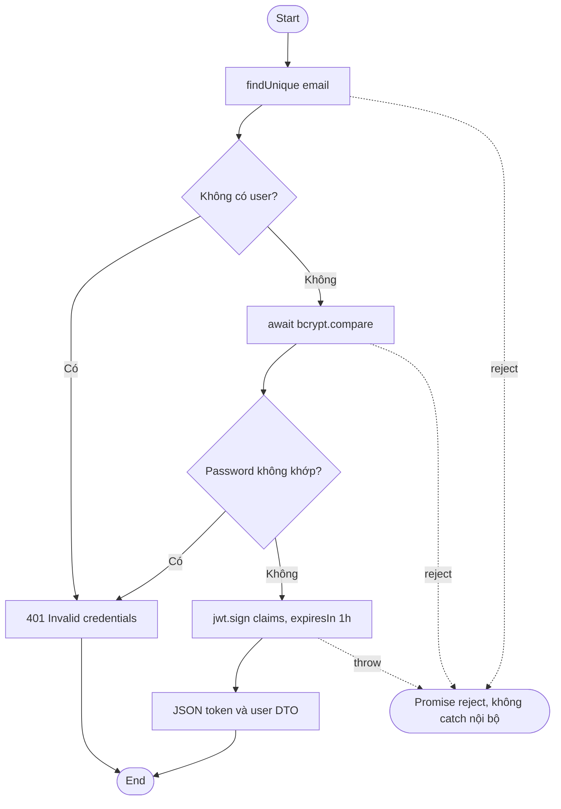
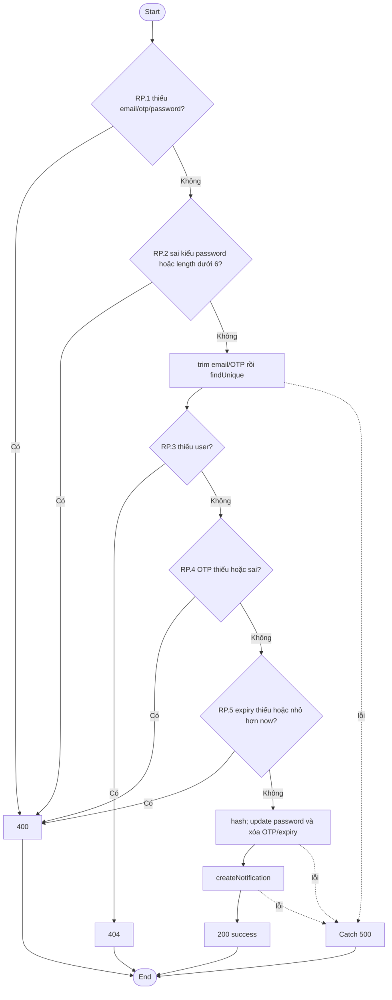
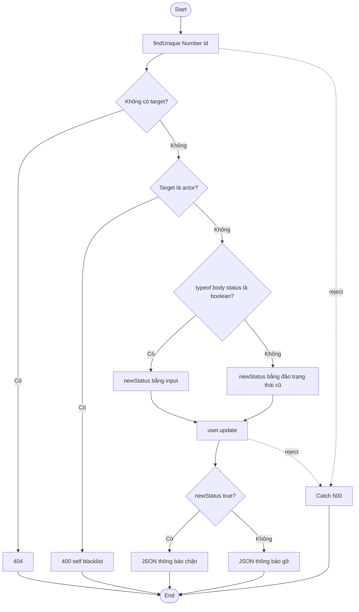
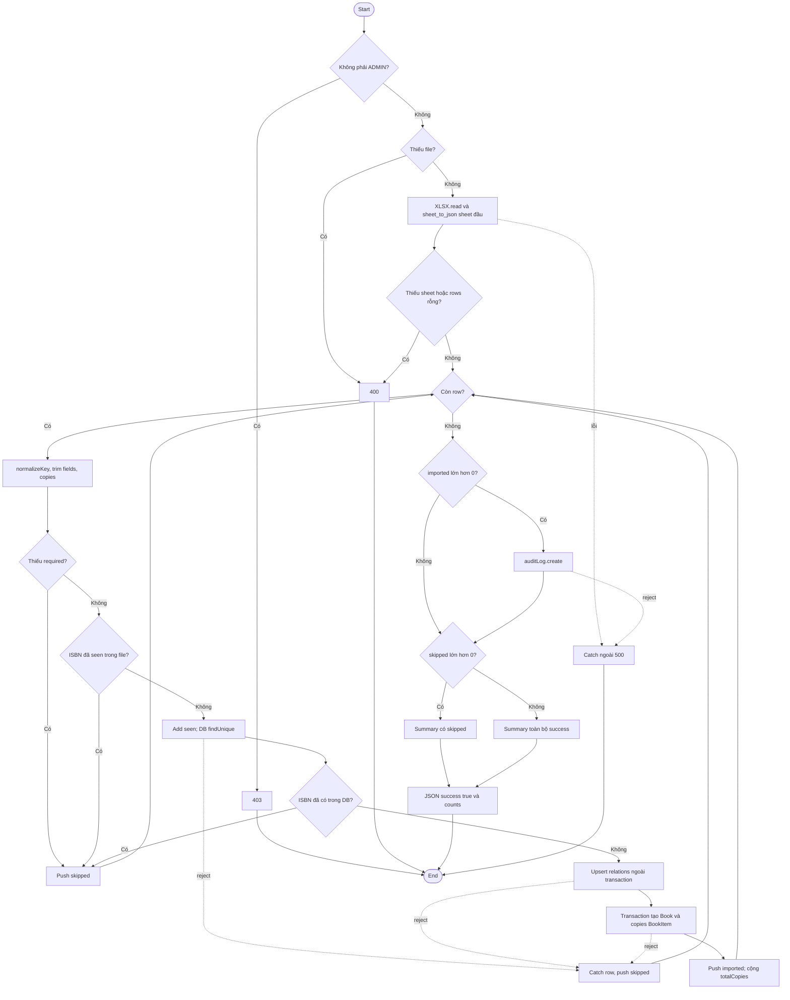
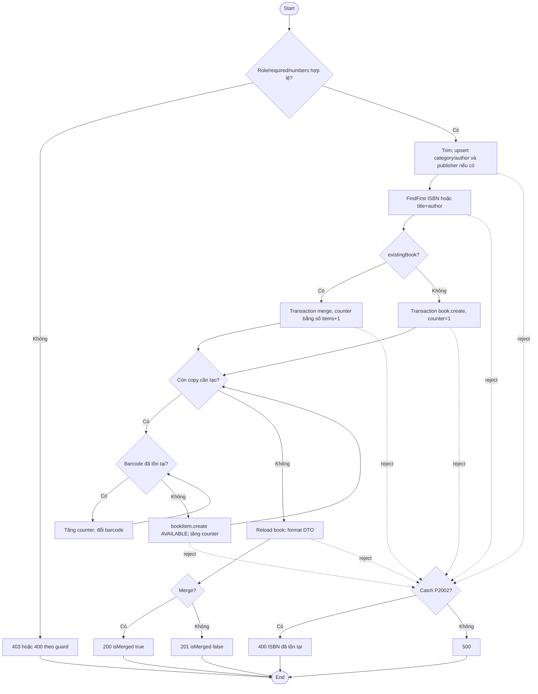

# Kế hoạch White-box Testing — Library Management System

Ngày khảo sát: **2026-10-11**. Phiên bản mã nguồn: Git HEAD `3623171535cde61d8fb8dd7f02d248da3864e2e5`; đây là snapshot workspace đang có, không phải xác nhận commit đã chạy Manual Testing. Trạng thái tài liệu: **kế hoạch, chưa triển khai hoặc thực thi Unit Test, chưa đo coverage**.

## 1. Căn cứ và phạm vi của Tester

Đã đối chiếu cả bốn tài liệu: [Manual_Test_Results_v2.xlsx](../output/Manual_Test_Results_v2.xlsx), [Defect_Log_v2.xlsx](../output/Defect_Log_v2.xlsx), [Manual_Test_Gap_Analysis_v2.md](../output/Manual_Test_Gap_Analysis_v2.md), [Manual_Test_Updated_v2.docx](../output/Manual_Test_Updated_v2.docx). Không thiếu tài liệu baseline v2. Baseline có 44 testcase: 30 PASS, 3 FAIL, 0 BLOCKED, 0 NOT RUN, 11 chưa kết luận chính thức; 3 Confirmed Defects, 6 Potential Defects. Các số này là ghi nhận Manual Testing trước đó, không phải kết quả white-box.

Kế hoạch đề xuất **160 testcase thiết kế** cho **24 mục tiêu hàm/callback**, gồm 52 Authentication, 30 Member Management, 48 Book Management và 30 Excel Import. Excel Import thuộc module ưu tiên thứ ba. Có 18 ca cần chốt oracle/nghiệp vụ trước assertion chức năng; 142 ca có oracle từ baseline hoặc hành vi mã nguồn được phân loại rõ. Mỗi ID là một thiết kế; nhóm dữ liệu tham số hóa có thể tạo nhiều lượt test runner sau này. Không chuyển đổi 44 manual cases thành 160 kết quả thực thi.

Chọn đúng ba module được yêu cầu. Authentication có mật khẩu/OTP/quyền; Member có DEF-001, DEF-002 và POT-005; Book/Excel có vòng lặp, transaction, điều kiện nhiều toán hạng và hai quy tắc trùng ISBN khác nhau. Middleware xác thực được bổ sung vì bảo vệ các API này, không mở rộng sang module nghiệp vụ của thành viên khác.

## 2. Cấu trúc thực tế và công cụ hiện có

```text
package.json                     # type=module; dev chạy client+server; chưa có test script
vite.config.ts                   # Vite 6.3.5, React plugin 4.7.0, Tailwind, alias @ → src
src/app/components/              # Login, MembersManagement, BooksManagement, ImportExcelModal
src/app/contexts/                # AuthContext, LanguageContext
src/app/api/client.ts            # axios; API localhost:5000/api
server/package.json              # type=commonjs; test hiện chỉ echo lỗi rồi exit 1
server/tsconfig.json             # strict TS; module commonjs; rootDir src
server/src/controllers/          # authController.ts, bookController.ts và module khác
server/src/middleware/auth.ts
server/src/routes/               # authRoutes.ts, bookRoutes.ts
server/src/services/             # mailService.ts, notificationService.ts
server/src/index.ts              # nạp routes, startReminderCron, app.listen
server/prisma/schema.prisma      # SQLite url=file:./dev.db, role/tier mặc định USER/STANDARD
docs/qa/output/                  # baseline v2
```

Frontend React 18.3.1, TanStack Query 5, axios, xlsx 0.18.5; backend Express 5, Prisma 5.22, bcryptjs 3, jsonwebtoken 9, Multer 2, xlsx 0.18.5, TypeScript 5.9.3. Node thực tế kiểm tra được **22.23.3**. Không phát hiện file Unit Test thực tế trong `src/` hoặc `server/src/`; `ui/aspect-ratio.tsx` không phải test dù tên chứa “spec”. Vitest, coverage-v8, jsdom, React Testing Library chưa được cài ở root. Không cài dependency trong nhiệm vụ lập kế hoạch.

Quản lý thành viên **không có controller riêng**: register/getAllUsers/toggleBlacklist nằm trong authController. Route `POST /api/auth/register` public; users/blacklist dùng authenticateToken rồi authorizeAdmin. Book create/update/delete/import dùng authenticateToken ở route và kiểm tra ADMIN trong controller. `getBooks` public; recommendations dùng optionalAuthenticateToken. Nguồn: [authRoutes.ts](../../../server/src/routes/authRoutes.ts), [bookRoutes.ts](../../../server/src/routes/bookRoutes.ts).

## 3. Truy vết baseline và thứ tự rủi ro

| Baseline | Nguồn/đích white-box | Ưu tiên và giới hạn |
| --- | --- | --- |
| AUTH-01 / POT-001 | login; authenticateToken | P0: login có một OR credential; không có OTP login. Login.tsx chỉ mở modal OTP cho forgot/reset. Cần xác nhận popup/môi trường/yêu cầu MFA trước tạo assertion OTP đăng nhập. |
| AUTH-02 / MEM-03 | register | Duplicate → 400; không nhầm mọi create error với unique error trong phân tích. |
| AUTH-04 | authorizeAdmin + route users/blacklist | P0 quyền API. Không coi middleware test là kiểm thử trang 403 frontend. |
| AUTH-05 / AUTH-06 | changePassword; forgotPassword; resetPassword | P0 mật khẩu/OTP; kiểm tra return sớm không lưu, password mới/cũ và xóa OTP bằng record RAM. |
| MEM-02 / DEF-001 | MembersManagement.handleAddMember; register | P0 validation thiếu; chính sách email/HTTP/message cần chốt. Không suy từ source rằng bcrypt/login tự từ chối email thiếu @. |
| MEM-05 / DEF-002 | addUserMutation gửi form → register → getAllUsers DTO | P0 hạng LECTURER/PREMIUM phải được giữ theo Expected; code bỏ membershipTier. Test mô phỏng không xác nhận persistence SQLite thật. |
| MEM-05 / POT-005 | register role USER; route register public | Oracle ADMIN cần chốt luồng được cấp quyền; không đề xuất forward role vô điều kiện từ public request. |
| MEM-01 / MEM-04 | filteredMembers; toggleBlacklist; handleToggleBlacklist | P1 filter/count/state. Hiệu lực chặn mượn nằm ngoài unit scope này. |
| BOOK-01 / POT-002 | BooksManagement callback filteredBooks; Header input | Catalog có filter thật; Header.tsx:128 không có handler query. Không bịa hàm search Header; giữ requirement clarification. |
| BOOK-02/04/05/06/07/10 | formatBookResponse; createBook; updateBook; deleteBook | P1 số bản, guard, merge, barcode. BOOK-06 thêm sách trùng ISBN là merge. |
| EXCEL-02/03/04 | validateAndSetFile; uploadExcel.fileFilter; importBooks.normalizeKey/importBooks | P0/P1 parser/row loop/error/transaction. EXCEL-03 dòng trùng là skip, không dùng merge BOOK-06. |
| DASH-02 / DEF-003 | Không chọn triển khai trong bộ unit này | PDF font cần browser/PDF evidence riêng, ít phù hợp unit logic so với ba module đã chọn; không gộp INV-05 hoặc sửa defect. |


AUTH-03 logout/navigation, BOOK-03 recommendations, BOOK-08 e-book, BOOK-09 bản in barcode, EXCEL-01 template download chưa được bao phủ toàn bộ bởi ma trận này. Đề nghị giai đoạn sau trong phạm vi Tester khi yêu cầu đã rõ. `downloadImportTemplate`, `getBookRecommendations`, `uploadEbookHandler`, uploadEbook cùng các UI callbacks khác có tồn tại nhưng chưa chọn testcase riêng. Không gán PASS/coverage cho phần chưa test. Các module Reservation, Dashboard, Payment, Inventory và Mail delivery thực không nằm trong unit scope này.

## 4. Danh sách hàm/callback được chọn

| ID | Module | Hàm/callback thực tế | File và dòng | Ưu tiên | Cách test |
| --- | --- | --- | --- | --- | --- |
| AT | Authentication | authenticateToken | [server/src/middleware/auth.ts:12](../../../server/src/middleware/auth.ts#L12) | P0 | Unit middleware; mock JWT, req/res/next |
| AA | Authentication | authorizeAdmin | [server/src/middleware/auth.ts:25](../../../server/src/middleware/auth.ts#L25) | P0 | Unit middleware; không DB |
| OA | Authentication | optionalAuthenticateToken | [server/src/middleware/auth.ts:32](../../../server/src/middleware/auth.ts#L32) | P2 | Unit middleware; mock JWT |
| LG | Authentication | login | [server/src/controllers/authController.ts:30](../../../server/src/controllers/authController.ts#L30) | P0 | Unit controller; mock Prisma/bcrypt/JWT |
| ME | Authentication | getMe | [server/src/controllers/authController.ts:57](../../../server/src/controllers/authController.ts#L57) | P1 | Unit controller; mock Prisma |
| CP | Authentication | changePassword | [server/src/controllers/authController.ts:139](../../../server/src/controllers/authController.ts#L139) | P0 | Unit controller; mock Prisma/bcrypt/notification |
| FP | Authentication | forgotPassword | [server/src/controllers/authController.ts:197](../../../server/src/controllers/authController.ts#L197) | P1 | Unit controller; mock Prisma/mail/clock/random |
| RP | Authentication | resetPassword | [server/src/controllers/authController.ts:245](../../../server/src/controllers/authController.ts#L245) | P0 | Unit controller; mock Prisma/bcrypt/notification/clock |
| RG | Member Management | register | [server/src/controllers/authController.ts:11](../../../server/src/controllers/authController.ts#L11) | P0 | Unit controller; mock Prisma/bcrypt |
| GU | Member Management | getAllUsers | [server/src/controllers/authController.ts:77](../../../server/src/controllers/authController.ts#L77) | P1 | Unit controller; mock Prisma |
| TB | Member Management | toggleBlacklist | [server/src/controllers/authController.ts:93](../../../server/src/controllers/authController.ts#L93) | P1 | Unit controller; mock Prisma |
| MA | Member Management | MembersManagement.handleAddMember | [src/app/components/MembersManagement.tsx:95](../../../src/app/components/MembersManagement.tsx#L95) | P0 | Component unit; handler closure, mock HTTP |
| MF | Member Management | MembersManagement — callback của members.filter (filteredMembers) | [src/app/components/MembersManagement.tsx:100](../../../src/app/components/MembersManagement.tsx#L100) | P1 | Logic thuần nằm trong component; test qua DOM với data mock |
| MT | Member Management | MembersManagement.handleToggleBlacklist | [src/app/components/MembersManagement.tsx:81](../../../src/app/components/MembersManagement.tsx#L81) | P1 | Component unit; mock confirm và HTTP |
| GB | Book Management | getBooks | [server/src/controllers/bookController.ts:116](../../../server/src/controllers/bookController.ts#L116) | P1 | Unit controller; mock Prisma; gọi helper thật |
| BF | Book Management | formatBookResponse (private) | [server/src/controllers/bookController.ts:83](../../../server/src/controllers/bookController.ts#L83) | P1 | Logic thuần; truy cập gián tiếp qua getBooks |
| CB | Book Management | createBook | [server/src/controllers/bookController.ts:135](../../../server/src/controllers/bookController.ts#L135) | P1 | Unit controller; mock Prisma và transaction callback |
| UB | Book Management | updateBook | [server/src/controllers/bookController.ts:340](../../../server/src/controllers/bookController.ts#L340) | P1 | Unit controller; mock Prisma |
| DB | Book Management | deleteBook | [server/src/controllers/bookController.ts:464](../../../server/src/controllers/bookController.ts#L464) | P1 | Unit controller; mọi delete chỉ mock |
| XF | Excel Import | uploadExcel — fileFilter callback | [server/src/controllers/bookController.ts:13](../../../server/src/controllers/bookController.ts#L13) | P1 | Unit callback cấu hình; capture bằng mock multer |
| IB | Excel Import | importBooks | [server/src/controllers/bookController.ts:525](../../../server/src/controllers/bookController.ts#L525) | P0 | Unit controller; mock XLSX/Prisma, transaction callback |
| NK | Excel Import | importBooks.normalizeKey (nested, private) | [server/src/controllers/bookController.ts:562](../../../server/src/controllers/bookController.ts#L562) | P1 | Logic thuần; kiểm tra gián tiếp qua importBooks |
| BS | Book Management | BooksManagement — callback của books.filter (filteredBooks) | [src/app/components/BooksManagement.tsx:342](../../../src/app/components/BooksManagement.tsx#L342) | P1 | Logic thuần trong component; DOM + mock HTTP/providers |
| EV | Excel Import | ImportExcelModal.validateAndSetFile | [src/app/components/ImportExcelModal.tsx:72](../../../src/app/components/ImportExcelModal.tsx#L72) | P1 | Component unit; selected file giả lập trong RAM, không upload thật |


Tên có tiền tố component chỉ mô tả vị trí closure thật, không phải export mới. Hai filter là callback anonymous; `filteredMembers`/`filteredBooks` là biến. `formatBookResponse` private, `normalizeKey` nested private: test qua controller gọi chúng, không sửa source để export và không sao chép thuật toán sang test.

## 5. Phân tích từng hàm

Mỗi mã `XX.n` là nhãn phân tích điều kiện/nhánh gắn với biểu thức thực tế, không phải instrumentation counter của Vitest. `E` là đường exception; `GAP` là nhánh còn thiếu, không tính như if đang tồn tại. Các hàm/callback được chọn không có switch/case; nhánh chủ yếu là if, early return, ternary, &&/||, optional chaining, vòng for/while và catch. Condition coverage phải xét từng toán hạng được đánh giá, không chỉ kết quả if. Chi tiết testcase nằm trong [ma trận](Whitebox_Test_Matrix.md).

### AT — authenticateToken

Nguồn: [server/src/middleware/auth.ts:12](../../../server/src/middleware/auth.ts#L12). Unit middleware; mock JWT, req/res/next.

- AT.1: authHeader && authHeader.split(' ')[1] — có/không header, có/không token.
- AT.2: !token — 401 hoặc gọi verify.
- AT.3: err trong callback verify — 403 hoặc gán req.user và next().

**Đường đi:** Không header → 401; token thiếu → 401; JWT lỗi → 403; hợp lệ → next đúng một lần.

**Biên dữ liệu:** Header undefined, Bearer không có token, token hết hạn/sai chữ ký qua mock error.

**Rủi ro/giới hạn:** Không kiểm tra tiền tố Bearer, hình dạng payload hay revocation trong hàm; không suy ra logout vô hiệu hóa JWT phía server.

**Test dự kiến:** WB-AT-01, WB-AT-02, WB-AT-03, WB-AT-04.

### AA — authorizeAdmin

Nguồn: [server/src/middleware/auth.ts:25](../../../server/src/middleware/auth.ts#L25). Unit middleware; không DB.

- AA.1: req.user?.role !== 'ADMIN' — thiếu user/USER bị 403; ADMIN gọi next.

**Đường đi:** Thiếu user và USER → chặn; ADMIN → tiếp tục.

**Biên dữ liệu:** user undefined, role USER, ADMIN.

**Rủi ro/giới hạn:** 403 API khác trang 403 trên frontend của AUTH-04; cần kiểm thử giao diện riêng.

**Test dự kiến:** WB-AA-01, WB-AA-02, WB-AA-03.

### OA — optionalAuthenticateToken

Nguồn: [server/src/middleware/auth.ts:32](../../../server/src/middleware/auth.ts#L32). Unit middleware; mock JWT.

- OA.1: authHeader && authHeader.split(' ')[1].
- OA.2: !token — next ngay hoặc verify.
- OA.3: if (user) trong callback — gán user hoặc giữ anonymous; _err không được dùng.

**Đường đi:** Anonymous → next; token lỗi, không user → next; token đúng → gán user rồi next.

**Biên dữ liệu:** Không header; verify(error, undefined); verify(null, user).

**Rủi ro/giới hạn:** Được dùng cho recommendations; cơ chế optional không được thay thành auth bắt buộc chỉ để test xanh.

**Test dự kiến:** WB-OA-01, WB-OA-02, WB-OA-03.

### LG — login

Nguồn: [server/src/controllers/authController.ts:30](../../../server/src/controllers/authController.ts#L30). Unit controller; mock Prisma/bcrypt/JWT.

- LG.1: !user || !(await bcrypt.compare(password, user.password)) — OR short-circuit: thiếu user không gọi compare; sai password → 401; đúng → ký JWT.

**Đường đi:** Không tồn tại → 401; tồn tại+sai password → 401; đúng → token 1h và DTO không có password.

**Biên dữ liệu:** findUnique null; compare false/true; USER/ADMIN từ bản ghi mock.

**Rủi ro/giới hạn:** Không có OTP login, email trim/lowercase, blacklist guard hoặc try/catch tại đây. Blacklist trong schema ghi là chặn mượn; không tự đặt quy tắc chặn login. Lỗi findUnique/compare/sign có thể reject; xử lý lỗi Express là kiểm thử riêng.

**Test dự kiến:** WB-LG-01, WB-LG-02, WB-LG-03, WB-LG-04.

### ME — getMe

Nguồn: [server/src/controllers/authController.ts:57](../../../server/src/controllers/authController.ts#L57). Unit controller; mock Prisma.

- ME.1: !req.user — 401.
- ME.2: !user sau findUnique — 404 hoặc trả DTO.

**Đường đi:** Anonymous → 401; JWT user nhưng không có bản ghi → 404; tồn tại → thông tin an toàn.

**Biên dữ liệu:** req.user undefined; record null; record có tier và blacklist.

**Rủi ro/giới hạn:** select chỉ lấy id/email/name/role/membershipTier/isBlacklisted/createdAt; không password/resetOtp. Không có catch nội bộ.

**Test dự kiến:** WB-ME-01, WB-ME-02, WB-ME-03.

### CP — changePassword

Nguồn: [server/src/controllers/authController.ts:139](../../../server/src/controllers/authController.ts#L139). Unit controller; mock Prisma/bcrypt/notification.

- CP.1: !userId — 401; optional chaining lấy userId.
- CP.2: !currentPassword || !newPassword — mỗi toán hạng T/F khi thực sự được đánh giá.
- CP.3: newPassword.length < 6 — 400.
- CP.4: !user — 404.
- CP.5: !isMatch — 400.
- CP.6: currentPassword === newPassword — 400.
- CP.E: try/catch — hash/update/notification lỗi → 500; thành công → json.

**Đường đi:** Các guard return sớm; đúng password+khác password mới → hash → update → notification → 200.

**Biên dữ liệu:** Thiếu từng password; độ dài 5/6/7; giống/khác; user null; compare false.

**Rủi ro/giới hạn:** Không kiểm tra kiểu newPassword như resetPassword. Notification service thực tế bắt lỗi DB và trả null; mock reject chỉ kiểm tra catch của controller, không chứng minh SMTP/DB. Update đã xong rồi notification reject có thể trả 500 mà không rollback.

**Test dự kiến:** WB-CP-01, WB-CP-02, WB-CP-03, WB-CP-04, WB-CP-05, WB-CP-06, WB-CP-07, WB-CP-08, WB-CP-09, WB-CP-10, WB-CP-11.

### FP — forgotPassword

Nguồn: [server/src/controllers/authController.ts:197](../../../server/src/controllers/authController.ts#L197). Unit controller; mock Prisma/mail/clock/random.

- FP.1: !email || typeof email !== 'string' — thiếu, sai kiểu, chuỗi hợp lệ.
- FP.2: !user — 404.
- FP.3: mailResult.previewUrl || undefined — preview có/không.
- FP.E: catch ngoài — lookup/update/mail lỗi → 500.

**Đường đi:** Kiểm tra kiểu → trim+lowercase → lookup → sinh OTP → lưu hạn 15 phút → gửi mail → json.

**Biên dữ liệu:** email empty/number; khoảng trắng, chữ hoa; Math.random 0 và gần 1 → OTP 100000 và 999999; expiry T+900000 ms.

**Rủi ro/giới hạn:** Guard không kiểm tra regex email, chuỗi chỉ có khoảng trắng vẫn đi tới lookup. Không gọi SMTP thật; OTP này dùng reset password, không phải login MFA.

**Test dự kiến:** WB-FP-01, WB-FP-02, WB-FP-03, WB-FP-04, WB-FP-05, WB-FP-06, WB-FP-07, WB-FP-08.

### RP — resetPassword

Nguồn: [server/src/controllers/authController.ts:245](../../../server/src/controllers/authController.ts#L245). Unit controller; mock Prisma/bcrypt/notification/clock.

- RP.1: !email || !otp || !newPassword — OR 3 toán hạng.
- RP.2: typeof newPassword !== 'string' || newPassword.length < 6 — kiểu sai short-circuit tránh đọc length.
- RP.3: !user — 404.
- RP.4: !user.resetOtp || user.resetOtp !== cleanOtp — thiếu OTP lưu/sai mã/khớp.
- RP.5: !user.resetOtpExpiry || new Date(user.resetOtpExpiry) < new Date() — thiếu/hết hạn/còn hạn.
- RP.E: catch ngoài — lỗi dependency hay email.trim sai kiểu → 500.

**Đường đi:** Thiếu input → 400; user thiếu → 404; OTP sai/hết hạn → 400 không hash/update; đúng → hash/update password, xóa OTP, notification.

**Biên dữ liệu:** Password 5/6; OTP chuỗi hoặc số, có whitespace; expiry T−1 ms/T/T+1 ms; OTP đã xóa.

**Rủi ro/giới hạn:** So sánh hạn là <, nên đúng thời điểm T không bị loại theo code. Đây là đặc trưng mã nguồn cần QA chốt biên, không phải sửa Expected AUTH-06. Email truthy sai kiểu lọt RP.1 rồi gây lỗi trim. Không chứng minh chống replay/concurrency bằng mock đơn luồng.

**Test dự kiến:** WB-RP-01, WB-RP-02, WB-RP-03, WB-RP-04, WB-RP-05, WB-RP-06, WB-RP-07, WB-RP-08, WB-RP-09, WB-RP-10, WB-RP-11, WB-RP-12, WB-RP-13, WB-RP-14, WB-RP-15, WB-RP-16.

### RG — register

Nguồn: [server/src/controllers/authController.ts:11](../../../server/src/controllers/authController.ts#L11). Unit controller; mock Prisma/bcrypt.

- RG.1: try/catch quanh user.create — resolve → 201, mọi reject → 400 User already exists.
- RG.0: hash trước try; hash reject không đi vào catch.
- RG.GAP: không có nhánh validation email/name/password; destructure chỉ email/password/name, role cố định USER, membershipTier không được truyền.

**Đường đi:** Hash → create → 201; create reject → 400; hash reject → promise reject.

**Biên dữ liệu:** Email hợp lệ/trùng/thiếu @; STANDARD/PREMIUM/LECTURER; role USER/ADMIN từ form.

**Rủi ro/giới hạn:** DEF-001/MEM-02: chưa biết nguyên nhân riêng của lần login thất bại; source chỉ cho thấy không có email validation. DEF-002/MEM-05: bỏ hạng làm Prisma dùng STANDARD. POST /register public; sửa lưu role cần đồng thời giải quyết quyền tạo Admin, không tin role do client gửi.

**Test dự kiến:** WB-RG-01, WB-RG-02, WB-RG-03, WB-RG-04, WB-RG-05, WB-RG-06, WB-RG-07.

### GU — getAllUsers

Nguồn: [server/src/controllers/authController.ts:77](../../../server/src/controllers/authController.ts#L77). Unit controller; mock Prisma.

- GU.1: không có if/else; findMany select DTO và orderBy id asc, rồi res.json.

**Đường đi:** Danh sách rỗng/non-empty trả nguyên DTO; kiểm tra truy vấn không chọn password/resetOtp.

**Biên dữ liệu:** []; hai member role/tier/blacklist khác nhau.

**Rủi ro/giới hạn:** Không ép database mock thực hiện sort/filter select; assert đúng query select/orderBy, và response đúng return value. Quyền ADMIN ở middleware route, không trong hàm.

**Test dự kiến:** WB-GU-01, WB-GU-02.

### TB — toggleBlacklist

Nguồn: [server/src/controllers/authController.ts:93](../../../server/src/controllers/authController.ts#L93). Unit controller; mock Prisma.

- TB.1: !targetUser — 404.
- TB.2: targetUser.id === req.user?.userId — tự thao tác bị 400.
- TB.3: typeof isBlacklisted === 'boolean' ? isBlacklisted : !targetUser.isBlacklisted — explicit boolean hoặc đảo trạng thái.
- TB.4: newStatus ? thông báo chặn : thông báo gỡ chặn.
- TB.E: catch → 500.

**Đường đi:** Không user → 404; self → 400; explicit true/false; thiếu/sai kiểu → toggle; lỗi lookup/update → 500.

**Biên dữ liệu:** Cùng/khác id; true/false/undefined/chuỗi false; trạng thái cũ true/false.

**Rủi ro/giới hạn:** Number(id) không có guard NaN; API được route authenticateToken+authorizeAdmin bảo vệ. Unit trạng thái không chứng minh chặn mượn tại loanController (ngoài phạm vi).

**Test dự kiến:** WB-TB-01, WB-TB-02, WB-TB-03, WB-TB-04, WB-TB-05, WB-TB-06, WB-TB-07, WB-TB-08.

### MA — MembersManagement.handleAddMember

Nguồn: [src/app/components/MembersManagement.tsx:95](../../../src/app/components/MembersManagement.tsx#L95). Component unit; handler closure, mock HTTP.

- MA.1: !newMember.name || !newMember.email — return hoặc addUserMutation.mutate.
- MA.GAP: không kiểm tra định dạng email, không trim; nút onClick trong div, không phải native form submit.

**Đường đi:** Thiếu từng field → không post; có field → gửi toàn bộ name/email/password/role/tier.

**Biên dữ liệu:** name/email empty; email thiếu @; lựa chọn LECTURER/PREMIUM.

**Rủi ro/giới hạn:** type=email không tự validate khi nút onClick gọi handler. Không export handler để test; thao tác qua DOM, chặn client trước import.

**Test dự kiến:** WB-MA-01, WB-MA-02, WB-MA-03, WB-MA-04.

### MF — MembersManagement — callback của members.filter (filteredMembers)

Nguồn: [src/app/components/MembersManagement.tsx:100](../../../src/app/components/MembersManagement.tsx#L100). Logic thuần nằm trong component; test qua DOM với data mock.

- MF.1: name.includes(q) || email.includes(q), cả hai lowerCase.
- MF.2: statusFilter === 'ALL' || (statusFilter === 'ACTIVE' && !member.isBlacklisted) || (statusFilter === 'BLACKLISTED' && member.isBlacklisted).
- MF.3: matchesSearch && matchesStatus.
- MF.4: blacklistedCount = filter(isBlacklisted).length; activeCount = filter(!isBlacklisted).length.

**Đường đi:** Tên match; chỉ email match; không match; ALL/ACTIVE/BLACKLISTED; search match nhưng trạng thái không match.

**Biên dữ liệu:** Query rỗng/hoa/thường; isBlacklisted true/false/undefined; bộ dữ liệu hai thành viên.

**Rủi ro/giới hạn:** Callback không có tên hàm/export; filteredMembers là biến. Không bịa helper filterMembers. Active tại đây nghĩa chưa blacklist, không tự đồng nhất KPI Dashboard.

**Test dự kiến:** WB-MF-01, WB-MF-02, WB-MF-03, WB-MF-04, WB-MF-05, WB-MF-06.

### MT — MembersManagement.handleToggleBlacklist

Nguồn: [src/app/components/MembersManagement.tsx:81](../../../src/app/components/MembersManagement.tsx#L81). Component unit; mock confirm và HTTP.

- MT.1: willBlacklist = !member.isBlacklisted; ternary chọn lời xác nhận chặn/gỡ.
- MT.2: window.confirm(confirmMsg) — OK gọi mutate, Cancel không gọi.

**Đường đi:** Confirm cancel → không PATCH; confirm OK → gửi id và trạng thái đảo.

**Biên dữ liệu:** Member active/blacklisted; window.confirm true/false.

**Rủi ro/giới hạn:** Test chỉ kiểm tra thao tác UI và request, không quyền hoặc hiệu lực chặn mượn.

**Test dự kiến:** WB-MT-01, WB-MT-02, WB-MT-03.

### GB — getBooks

Nguồn: [server/src/controllers/bookController.ts:116](../../../server/src/controllers/bookController.ts#L116). Unit controller; mock Prisma; gọi helper thật.

- GB.1: try → findMany include relations/items, orderBy id asc; books.map(formatBookResponse).
- GB.E: catch → 500.

**Đường đi:** []; danh sách có bản sao; lookup reject.

**Biên dữ liệu:** 0/1/n books; item AVAILABLE/BORROWED/LOST.

**Rủi ro/giới hạn:** Response formatter không export, được kiểm tra gián tiếp qua getBooks. Không giả định mock Prisma tự JOIN.

**Test dự kiến:** WB-GB-01, WB-GB-02.

### BF — formatBookResponse (private)

Nguồn: [server/src/controllers/bookController.ts:83](../../../server/src/controllers/bookController.ts#L83). Logic thuần; truy cập gián tiếp qua getBooks.

- BF.1: book.items || []; status AVAILABLE dùng String(item.status).toUpperCase() === 'AVAILABLE'.
- BF.2: author?.name || '', category?.name || '', publisher?.name || ''; ebookUrl || null.
- BF.3: available > 0 ? 'Available' : 'Borrowed'; map items giữ id/barcode/location/status.

**Đường đi:** Không items → copies=0/available=0; một available → Available; toàn borrowed/lost → Borrowed.

**Biên dữ liệu:** items undefined/[]/3 phần tử; available/AVAILABLE/BORROWED/LOST; relations null; ebookUrl empty/present.

**Rủi ro/giới hạn:** Tên trạng thái Borrowed hiện dùng cả trường hợp 0 bản khả dụng vì LOST; phải phân biệt đặc trưng formatter với quy tắc nghiệp vụ đã chốt.

**Test dự kiến:** WB-BF-01, WB-BF-02, WB-BF-03.

### CB — createBook

Nguồn: [server/src/controllers/bookController.ts:135](../../../server/src/controllers/bookController.ts#L135). Unit controller; mock Prisma và transaction callback.

- CB.1: req.user?.role !== 'ADMIN' → 403.
- CB.2: !title || !author || !isbn || !category → 400 trước trim.
- CB.3: Number(copies) || 1; available !== undefined ? Number(available) : copiesNum.
- CB.4: copiesNum < 1; CB.5: availableNum < 0; CB.6: availableNum > copiesNum — ba guard riêng.
- CB.7: isbn ? String(isbn).trim() : ''; publisher && String(publisher).trim() ? trimmed : null; if(trimmedPublisher) upsert.
- CB.8: trimmedIsbn ? thêm ISBN vào query OR : bỏ; existingBook ? merge : tạo mới.
- CB.9: cleanIsbn digits.slice(-6) || 'BOOK', ở cả merge/new.
- CB.10: for i < copiesNum; while barcode đã tồn tại — tăng counter, retry tới barcode trống, ở cả merge/new.
- CB.11: publisherRecord ? id : null; publishedYear ? String : null; pageCount ? Number : null; language ? String : Tiếng Việt; description/coverImage || null; ebookUrl ? trim : null.
- CB.E: catch error.code === 'P2002' → 400; else → 500.

**Đường đi:** Quyền → required → số lượng → upsert relations → tìm trùng → merge 200 hoặc new 201; transaction tạo từng BookItem AVAILABLE; barcode collision retry.

**Biên dữ liệu:** copies −1/0/1/2/1.5/abc; available −1/0/copies/copies+1/NaN; whitespace fields; barcode collision 0/1/n.

**Rủi ro/giới hạn:** Copies 0/abc bị fallback 1, số lẻ làm vòng for chạy ceil; NaN available lọt guard. Có validation available nhưng không dùng để đặt status item; tất cả mới AVAILABLE. Upsert relation ở ngoài transaction. Không coi những điểm này là defect mới đã thực thi. BOOK-06 merge khác EXCEL-03 skip trùng.

**Test dự kiến:** WB-CB-01, WB-CB-02, WB-CB-03, WB-CB-04, WB-CB-05, WB-CB-06, WB-CB-07, WB-CB-08, WB-CB-09, WB-CB-10, WB-CB-11, WB-CB-12, WB-CB-13, WB-CB-14, WB-CB-15, WB-CB-16, WB-CB-17, WB-CB-18, WB-CB-19.

### UB — updateBook

Nguồn: [server/src/controllers/bookController.ts:340](../../../server/src/controllers/bookController.ts#L340). Unit controller; mock Prisma.

- UB.1: role !== ADMIN → 403; UB.2: isNaN(parseInt(id)) → 400; UB.3: !existingBook → 404.
- UB.4: field !== undefined cho title/isbn/publishedYear/pageCount/language/description/coverImage/ebookUrl; year/page/language/ebook có ternary truthy→value, falsy→null.
- UB.5: if(category), if(author) upsert hoặc không.
- UB.6: publisher !== undefined; nested if(publisher) upsert, else publisherId=null.
- UB.7: copies !== undefined && Number(copies) > 0; UB.8: targetCount > currentCount; for currentCount < targetCount.
- UB.9: isbn || existingBook.isbn khi tạo barcode tăng thêm.
- UB.E: catch code P2025 → 404; else if P2002 → 400; else → 500.

**Đường đi:** Guard → update metadata → chỉ thêm item khi target tăng → reload DTO. Target giảm không xóa item.

**Biên dữ liệu:** id abc/12abc; field undefined/empty/non-empty; copies undefined/0/n/n+1/n−1; publisher thiếu/empty/present.

**Rủi ro/giới hạn:** Không transaction metadata+items, không collision retry như createBook; lỗi thêm item có thể để metadata đã cập nhật. parseInt(12abc)=12; giảm copies chưa có oracle nghiệp vụ. Không sửa để ép PASS.

**Test dự kiến:** WB-UB-01, WB-UB-02, WB-UB-03, WB-UB-04, WB-UB-05, WB-UB-06, WB-UB-07, WB-UB-08, WB-UB-09, WB-UB-10, WB-UB-11, WB-UB-12.

### DB — deleteBook

Nguồn: [server/src/controllers/bookController.ts:464](../../../server/src/controllers/bookController.ts#L464). Unit controller; mọi delete chỉ mock.

- DB.1: role !== ADMIN → 403; DB.2: isNaN(bookId) → 400.
- DB.3: borrowedCount > 0 → 400 không delete.
- DB.4: itemIds.length > 0 — delete loan/items hoặc bỏ đoạn đó; luôn delete reservation rồi book.
- DB.E: catch P2025 → 404; else → 500.

**Đường đi:** Đang mượn → cấm; không mượn, có/không item → cascade mock theo thứ tự; lỗi → catch.

**Biên dữ liệu:** borrowedCount 0/1; itemIds []/[id]; id NaN.

**Rủi ro/giới hạn:** Nhiều delete không transaction; mock không chứng minh FK, rollback hoặc bảo toàn lịch sử. Không bao giờ gọi delete trên DB thật trong unit suite.

**Test dự kiến:** WB-DB-01, WB-DB-02, WB-DB-03, WB-DB-04, WB-DB-05, WB-DB-06, WB-DB-07.

### XF — uploadExcel — fileFilter callback

Nguồn: [server/src/controllers/bookController.ts:13](../../../server/src/controllers/bookController.ts#L13). Unit callback cấu hình; capture bằng mock multer.

- XF.1: allowed.includes(file.mimetype) || file.originalname.match(/\.(xlsx|xls)$/i) — OR: MIME đúng đủ để nhận, hoặc extension đúng; hai sai mới từ chối.
- XF.2: limits.fileSize=10*1024*1024; single(file); đây là cấu hình Multer, không phải if trong callback.

**Đường đi:** MIME hợp lệ → cb(null,true); MIME sai+đuôi xlsx → nhận; cả hai sai → cb(Error).

**Biên dữ liệu:** MIME allowed đúng extension sai; MIME sai với .XLSX; .txt+text/plain; 10 MiB giới hạn.

**Rủi ro/giới hạn:** Capture options bằng mock multer trước import, kiểm tra callback thực. Mock chỉ chứng minh cấu hình limits, chưa chứng minh Multer thực thi limit. application/octet-stream được cho phép; UI lại chỉ chấp nhận extension Excel.

**Test dự kiến:** WB-XF-01, WB-XF-02, WB-XF-03, WB-XF-04.

### IB — importBooks

Nguồn: [server/src/controllers/bookController.ts:525](../../../server/src/controllers/bookController.ts#L525). Unit controller; mock XLSX/Prisma, transaction callback.

- IB.1: role !== ADMIN → 403; IB.2: !req.file → 400; IB.3: !sheetName → 400; IB.4: rows.length === 0 → 400.
- IB.5: vòng rows i < length; vòng Object.keys(raw); title/author/isbn/category truthy ? trim : empty; copies=Math.max(1,parseInt(row.copies)||1).
- IB.6: !title || !author || !isbn || !category → skipped row=i+2 rồi continue.
- IB.7: seenIsbnsInFile.has(isbn.replace(/\s+/g,empty)) → skipped rồi continue; add trước try DB.
- IB.8: existingBook → skipped DB duplicate rồi continue; khác → upsert category/author.
- IB.9: publisherName truthy → upsert; publisherRecord ? id : null; year/page/language/description/cover có ternary.
- IB.10: cleanIsbn digits.slice(-6) || String(createdBook.id); transaction book+for j<copies item AVAILABLE.
- IB.E1: catch từng dòng → skipped reason err.message || fallback, rồi tiếp tục dòng sau.
- IB.11: imported.length > 0 → auditLog.create; IB.12: skipped.length > 0 → summary hỗn hợp, else success toàn bộ.
- IB.E2: catch ngoài → 500 error.message || fallback; parser/audit có thể vào nhánh này.

**Đường đi:** Guard/parse → từng row missing/file-duplicate/DB-duplicate/success/error → audit nếu có success → summary. Dòng lỗi không chặn dòng sau; lỗi audit trả 500 sau khi các row đã được lưu.

**Biên dữ liệu:** Rows 0/1/n; copies undefined/−1/0/1/2/2.9/abc; ISBN có whitespace; optional fields missing/present; parser reject; transaction reject.

**Rủi ro/giới hạn:** Chỉ sheet đầu; normalize ISBN trong file khác query DB dùng isbn đã trim; seen được add dù row DB lỗi. Relations upsert ngoài transaction, audit ngoài transaction. Callback mock không chứng minh atomicity, khóa/unique hay rollback thật.

**Test dự kiến:** WB-IB-01, WB-IB-02, WB-IB-03, WB-IB-04, WB-IB-05, WB-IB-06, WB-IB-07, WB-IB-08, WB-IB-09, WB-IB-10, WB-IB-11, WB-IB-12, WB-IB-13, WB-IB-14, WB-IB-15, WB-IB-16, WB-IB-17, WB-IB-18, WB-IB-19, WB-IB-20, WB-IB-21, WB-IB-22, WB-IB-23.

### NK — importBooks.normalizeKey (nested, private)

Nguồn: [server/src/controllers/bookController.ts:562](../../../server/src/controllers/bookController.ts#L562). Logic thuần; kiểm tra gián tiếp qua importBooks.

- NK.1: key.trim().toLowerCase(); colMap[normalized] || normalized — alias biết → canonical, unknown → giữ key chuẩn hóa.

**Đường đi:** English/tiếng Việt có dấu/không dấu/case-whitespace → đúng canonical; unknown → không trở thành required field.

**Biên dữ liệu:** TITLE, Tiêu đề, ten sach, NXB, publishedYear; header lạ; nhiều alias cùng canonical ghi đè theo thứ tự Object.keys.

**Rủi ro/giới hạn:** Không strip dấu toàn diện; chỉ alias liệt kê. Không export hoặc sao chép lại logic vào test, vì bản sao sẽ không đo được source thật.

**Test dự kiến:** WB-IB-06, WB-IB-07, WB-IB-08.

### BS — BooksManagement — callback của books.filter (filteredBooks)

Nguồn: [src/app/components/BooksManagement.tsx:342](../../../src/app/components/BooksManagement.tsx#L342). Logic thuần trong component; DOM + mock HTTP/providers.

- BS.1: title.includes(q) || author.includes(q), lowerCase; BS.2: selectedCategory === 'All' || book.category === selectedCategory; BS.3: matchesSearch && matchesCategory.

**Đường đi:** Match tên/chỉ tác giả/no match; All/đúng/sai category; match search nhưng category sai.

**Biên dữ liệu:** Query rỗng, HOA/thường, category exact; bộ 2 sách khác tên/tác giả/category.

**Rủi ro/giới hạn:** Không tìm ISBN/barcode trong callback này. Header input dòng 128 không có onChange/onKeyDown/value hay liên kết query; chưa có hàm search Header để unit test. POT-002 vẫn cần chốt phạm vi yêu cầu.

**Test dự kiến:** WB-BS-01, WB-BS-02, WB-BS-03, WB-BS-04, WB-BS-05.

### EV — ImportExcelModal.validateAndSetFile

Nguồn: [src/app/components/ImportExcelModal.tsx:72](../../../src/app/components/ImportExcelModal.tsx#L72). Component unit; selected file giả lập trong RAM, không upload thật.

- EV.1: !file.name.match(/\.(xlsx|xls)$/i) → lỗi định dạng.
- EV.2: file.size > 10*1024*1024 → lỗi dung lượng; nếu không, setSelectedFile, setResult(null).

**Đường đi:** Sai extension → reject trước xét size; đúng+quá limit → reject; đúng+tại limit → chọn và xóa kết quả cũ.

**Biên dữ liệu:** .xlsx/.XLS/.txt; 10 MiB−1/10 MiB/10 MiB+1 byte.

**Rủi ro/giới hạn:** jsdom test không chứng minh Excel có nội dung hợp lệ; file parsing thuộc IB. 10 MiB dùng byte code, dù UI gọi 10MB.

**Test dự kiến:** WB-EV-01, WB-EV-02, WB-EV-03.

## 6. Control Flow Graph tiêu biểu

CFG phản ánh luồng mã nguồn hiện có, không phải quy tắc sửa lỗi tương lai. Các guard nhiều toán hạng của reset/import được gộp trong node để dễ đọc; bảng condition ở Coverage Strategy bổ sung short-circuit. Exception cạnh “lỗi” biểu diễn await reject; không cộng số đường để suy ra tỷ lệ coverage.

### 6.1. login — biểu thức OR và short-circuit



Ba đường Boolean cốt lõi: LG-01 bỏ compare; LG-02 compare false; LG-03/04 compare true. Những đường reject chưa có testcase riêng trong ma trận phiên bản này, phải ghi vào backlog thay vì khẳng định đã đủ path coverage.

### 6.2. resetPassword — guard và xóa OTP



RP-12 kiểm tra expiry T+1; RP-11 giữ cờ yêu cầu xác nhận tại T; RP-15 kiểm tra replay sau khi xóa mã. Không suy ra chống race condition từ record RAM.

### 6.3. toggleBlacklist — explicit Boolean và toggle



### 6.4. importBooks — dòng lỗi tiếp tục và lỗi ngoài vòng



Node thiếu sheet và rows rỗng là hai if liên tiếp trong source, tách IB-03/04 trong ma trận. Callback transaction thật được gọi bằng tx mock; không mô phỏng SQL rollback rồi coi như đã kiểm chứng DB.

### 6.5. createBook — new/merge và retry barcode



CFG gộp hai vòng for/while giống cấu trúc, nhưng source có hai bản riêng; cần CB-12 cho new và CB-13 cho merge, không coi chạy một vòng đã cover cả hai.

## 7. Logic thuần, phụ thuộc và giới hạn kết luận

| Loại | Logic thực tế | Chiến lược |
| --- | --- | --- |
| Thuần | formatBookResponse; normalizeKey; callback filter member/book | Gọi helper private qua controller thật; filter qua render component với data mock. Không tách helper hoặc thêm export trong nhiệm vụ này. |
| Điều phối nghiệp vụ | register/login/change/reset/blacklist/create/update/delete/import | Gọi controller bằng req/res mock; dependency mock, kiểm tra output và điều kiện không được gọi thao tác lưu khi guard fail. |
| Database | Prisma find/create/update/upsert/delete/$transaction/audit | Không kết nối SQLite. $transaction mock phải await callback(txMock), để chạy logic ứng dụng bên trong. Không chứng minh isolation/unique/FK/rollback thực. |
| Dịch vụ/side effect | mailService, notificationService, JWT, clock/random, filesystem, HTTP | Mock trước import. Bcrypt thật chỉ dùng cho hai ca đổi/reset rồi login trong RAM; không chạm DB. |
| UI | handler closures, native input, React Query, providers | React Testing Library/jsdom, client mock, QueryClient retry=false và cleanup sau test. Không gọi localhost:5000. |

Unit coverage chỉ cho thấy đoạn mã được đi qua. Tỷ lệ cao không xác nhận business rules đúng, persistence đúng, PDF/font đúng hay không còn defect. {ORACLES['R']} ca R cần xác nhận theo [ma trận](Whitebox_Test_Matrix.md); testcase regression theo Expected có thể thất bại trên source hiện tại, không đổi assertion để làm xanh. Không cập nhật trạng thái defect Fixed từ khảo sát source.

## 8. Điều kiện bắt đầu và kết thúc giai đoạn triển khai sau

Đầu vào cần sẵn sàng: chốt oracle R, nhất là email, luồng thêm ADMIN an toàn, số lượng/available và OTP tại T; chọn snapshot source; cài dev dependencies đã pin; hoàn thành mock trước import và kiểm tra cách nạp TypeScript CommonJS. Giữ bất biến DB chính, source ứng dụng và baseline.

Đầu ra triển khai sau: test source trong khu vực test riêng, log runner thật, assertions độc lập với implementation, coverage report thật cho phạm vi công bố, condition ledger có bằng chứng T/F/NE, defect/regression trace. Phần coverage thiếu hoặc testcase pending phải được giải thích. Các mục tiêu trong [Coverage Strategy](Whitebox_Coverage_Strategy.md) là tiêu chí dự kiến, không là thành tích hiện có.

Nhiệm vụ hiện tại kết thúc khi bốn tài liệu hoàn tất và đối chiếu đúng source/baseline. Không viết Unit Test, cài framework, chạy test/coverage, sửa app/schema/DB, seed/migrate, commit/push. [Implementation Plan](Whitebox_Implementation_Plan.md) chỉ hướng dẫn công việc tương lai và cách trình bày Chương 4.
