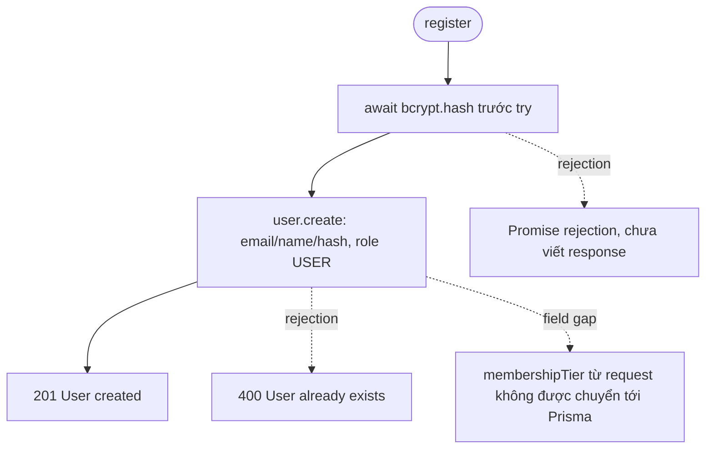
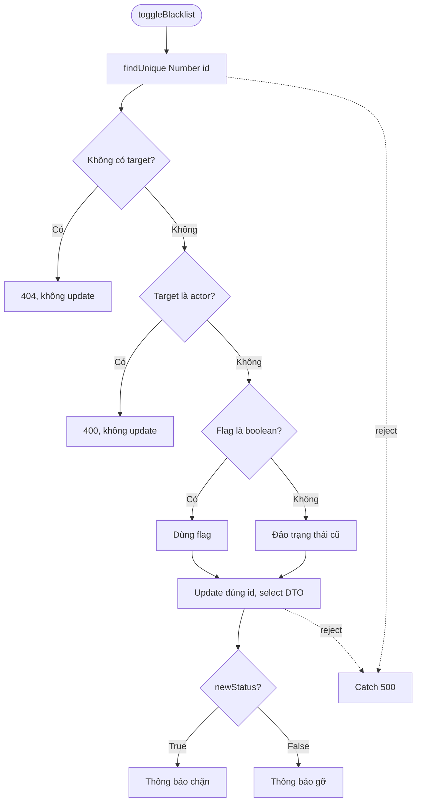

# Phase 3 — Member Source Analysis & Test Selection

Phân tích trước execution, dựa trên source và baseline đã có. Đây không phải kết quả PASS/FAIL. [Thiết kế 25 ca](../../../../../server/tests/fixtures/phase3-cases.json) giữ 15 ID trong Matrix; 10 ID bổ sung có mô tả oracle/branch/reason riêng. Không sửa Matrix/Expected/baseline cũ.

## Source, routes và mô hình thực

| Thành phần | Vị trí và vai trò |
| --- | --- |
| Member form/query/blacklist UI | [MembersManagement.tsx](../../../../../src/app/components/MembersManagement.tsx): addUserMutation:51–64 → POST `/auth/register`; handleAddMember:95–98 kiểm tra name/email truthy; query:42–48 → GET `/auth/users`; mutation blacklist:67–79 → PATCH `/auth/users/:id/blacklist`; role/tier selectors trong modal |
| Controller | [authController.ts](../../../../../server/src/controllers/authController.ts): register:11–28, getMe:57–75, getAllUsers:77–91, toggleBlacklist:93–137 |
| Routes | [authRoutes.ts](../../../../../server/src/routes/authRoutes.ts): POST `/register` public; GET `/me` authenticateToken; GET `/users` và PATCH `/users/:id/blacklist` authenticateToken → authorizeAdmin → controller |
| Middleware | [auth.ts](../../../../../server/src/middleware/auth.ts): authenticateToken:12–23, authorizeAdmin:25–30; role check ở route middleware, không nằm trong getAllUsers/toggleBlacklist |
| Services | Không có service Member CRUD riêng được gọi trong bốn hàm; controller gọi Prisma trực tiếp. Mail/notification được import cùng module nhưng không dùng trong bốn hàm; mock chúng trước import |
| Prisma | [schema.prisma](../../../../../server/prisma/schema.prisma): User.email String @unique; role String default USER; membershipTier String default STANDARD; isBlacklisted Boolean default false. Role/tier là String, không phải enum validation. Datasource SQLite file:./dev.db |

Public registration và form Admin dùng cùng register. Actor ADMIN trong unit regression mô tả context của form, không chứng minh register endpoint có authorization. Không forward role ADMIN vô điều kiện hoặc xác lập quyền tạo ADMIN từ hiện trạng code.

## Control flow và biên

| Function | Nhánh/đường đi thực | Các biên và giới hạn |
| --- | --- | --- |
| register | hash trước try; create resolve → 201; create reject → catch 400 User already exists; hash reject → promise rejection ngoài catch | Không có guard email/name/password; không destructure role/tier; role=USER. RG-01/02 đã có trong Phase 1 và được regression; thêm RG-03/04/05, không nhân bản IDs |
| getAllUsers | await findMany(select public fields, orderBy id asc) → res.json; không if/catch | [] / hai DTO; query reject propagated, không có response từ controller. Query intent không chứng minh ORM sort/select thực |
| getMe | !req.user → 401; query theo userId với select; !user → 404; else DTO | Actor thiếu, user thiếu, DTO có tier, query reject. Không bịa HTTP 500 khi chỉ thấy promise reject |
| toggleBlacklist | !target → 404; target.id===req.user?.userId → 400; typeof flag==='boolean' dùng flag, else !old; update/select → message ternary; catch → 500 | Boolean true/false; thiếu flag; trạng thái cũ false/true; target thiếu/self; lookup/update lỗi. Chuỗi false và id không hợp lệ cần contract riêng |

## Đối chiếu manual defects

- **DEF-001/MEM-02:** đã đọc Confirmed Defects row và Manual Results v2; DOCX hiện tại có heading đỏ #ff0000 và ghi chú italic rằng email không có @ tạo được nhưng không login được. Ảnh rId16 là form, chưa chứng minh đủ create/login thất bại. Source form chỉ kiểm tra truthy; input type=email nằm trong div và Save dùng onClick. Controller/login không có format validation; source không đủ giải thích vì sao lần login của Tester thất bại. Không dựng mock login failure để tuyên bố đã tái hiện DEF-001.
- **DEF-002/MEM-05:** heading cam #ff9900, ghi chú italic và cặp ảnh rId19/rId20 xác nhận chọn LECTURER nhưng hiển thị STANDARD; workbook mapping liên kết ảnh baseline. Expected gốc phải lưu đúng role/tier. Form gửi tier nhưng register bỏ field; schema default STANDARD là dấu hiệu phù hợp. RG-04/05 assert actual create arguments có tier đã chọn; nếu source bỏ field, giữ FAIL. Mock create return value không xác nhận DB persistence hoặc GUI hiển thị.
- **POT-005:** source role cố định USER là dấu hiệu, nhưng luồng cấp quyền tạo ADMIN chưa chốt; giữ RG-07 pending. Không đổi policy/public endpoint trong test hoặc production.

Manual và defect workbook giữ nguyên byte; không cập nhật trạng thái Fixed. Đã đọc DOCX bằng OOXML runs/color/italic/image relationships, không dùng plain text để đánh giá màu.

## Phạm vi test và mock

- 25 ca mới: 3 register regression/error boundary; 3 getAllUsers; 4 getMe; 8 blacklist; 7 permission wiring. Gọi source functions thật, hoisted mocks Prisma/bcrypt/JWT/mail/notification, alias fail-closed và gate trước body.
- Permission cases đọc registrations từ Router thật, assert identity/thứ tự handlers và gọi từng handler bằng req/res/next stubs. Không gọi Router.handle, HTTP/server/listener; đây là unit kiểm tra wiring/handlers, chưa kiểm chứng Express dispatch, URL params parsing hoặc response transport thật.
- Cùng runner/config, thêm selector LMS_WB_SCOPE=all/authentication/member; include source coverage giữ nguyên ba file shared authController/auth middleware/authRoutes. Member-only coverage là execution 25 ca trên nguyên ba file này; báo rõ phần source Authentication còn trong mẫu số.
- Có thể trình bày thêm coverage block của bốn function Member từ raw V8 maps với phạm vi/denominator riêng; không thay coverage include hoặc so block % với whole-file %.
- Fixture synthetic trong RAM; tuyệt đối không Prisma thật, seed/migration/main DB, SMTP/Ethereal hoặc production index/cron. Network guards và constructor/delegate gate được dùng lại.

## Pending và chưa triển khai

| Test ID | Lý do chưa có assertion thực thi |
| --- | --- |
| WB-RG-06 | Email không có @: cần chuỗi/email thực, thông báo login, contract validation; không lấy POST thành công làm oracle |
| WB-RG-07 | Cần chốt endpoint/quyền tạo ADMIN; tách Admin flow với public anonymous |
| WB-TB-07 | body.isBlacklisted chuỗi false: reject hay fallback toggle chưa chốt |
| WB-MA-04 | UI invalid email: phải chốt chính sách và kiểm tra DOM riêng |
| WB-RG-08 (bổ sung thiết kế) | Thiếu name/email/password: cần contract validation/status/message cho từng field |
| WB-RG-09 (bổ sung thiết kế) | Tier không thuộc STANDARD/PREMIUM/LECTURER: chưa chốt reject hoặc default |
| WB-RG-10 (bổ sung thiết kế) | Role không hợp lệ: chưa chốt contract public/Admin flow |
| WB-TB-10 (bổ sung thiết kế) | id không numeric/NaN: cần contract validation, không tự coi mock Prisma reject là validation thực |

Các ID này **PENDING DESIGN/REQUIREMENT**, không được đăng ký vào runner và không tính SKIPPED. UI MA/MF/MT có oracle B/S còn lại là backlog chưa triển khai trong Phase 3; không sao chép handler/filter ra helper để giả lập kiểm thử UI. Hạng STANDARD hợp lệ và email trùng đã có RG-01/02 trong regression; không nhân bản test chỉ để tăng số.

## Integration/E2E đề xuất, chưa thực hiện

1. DEF-001: môi trường DB disposable với datasource override được xác minh, browser/network capture email chính xác → create → query → login, cả email hợp lệ và email đã ghi nhận lỗi; không sửa Expected hoặc reset DB chính.
2. DEF-002: Admin form gửi LECTURER/PREMIUM/đối chứng STANDARD → POST request → query record sau create/reload → DTO/card sau refresh; lưu IDs/version/ảnh/request-response. Policy tạo ADMIN là case riêng sau xác nhận, không ghép với tier.
3. Permission/blacklist: test Express dispatch bằng app thử và mocks, sau đó DB integration/E2E cô lập nếu được giao; hiệu lực chặn mượn phối hợp scope Loan của người phụ trách. Unit flags/messages không chứng minh hiệu lực ở loanController.
